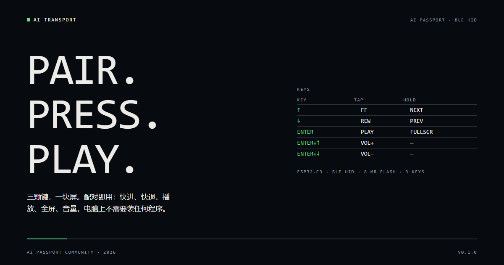

<p align="right">
  <a href="README.zh_CN.md">简体中文</a> · <strong>English</strong>
</p>

# AI Transport — a media remote for AI Passport

Three keys, one small screen, no software on the computer.
Pair it over Bluetooth LE HID and it sends the keys your player already listens for:
seek, play/pause, fullscreen, volume.



## Keys

| Key | Tap | Hold |
| --- | --- | --- |
| ↑ | Fast forward (keyboard →) | Next episode |
| ↓ | Rewind (keyboard ←) | Previous episode |
| OK | Play / pause (Consumer 0xCD) | Fullscreen (keyboard f) |
| OK + ↑ | Volume up (Consumer 0xE9) | — |
| OK + ↓ | Volume down (Consumer 0xEA) | — |

The screen is a blind-operation reference, not a player UI: device name, battery,
connection state, the four-row key legend, and the action name for 1.5 s after a
press. Backlight turns off after 10 s without a key and comes back on the next press.

There is no metadata channel and no computer-side program. Everything is standard
BLE HID (a keyboard collection plus a consumer-control collection), so it works with
any host that accepts a Bluetooth keyboard.

## Flash

1. Open the AI Passport web flasher:
   <https://ai-passport.folotoy.cn/tools/web-flasher/> (Chrome or Edge).
2. Pick `build/FoloToy-AI-Passport-full.bin` (or the release asset of the same name),
   choose 460800 baud, and write from `0x0`.
3. On the host, open Bluetooth settings, add a device, and select **AI Transport**.
   No PIN is required (Just Works pairing).
4. If the device was paired with another build before, remove it from the host's
   Bluetooth list and pair again.

## Build

Requires ESP-IDF 5.5.3 for ESP32-C3.

```bash
./tools/validate.sh --firmware   # build + merge + verify the merged image
```

The publishable artifact is the merged image `build/FoloToy-AI-Passport-full.bin`.
The app-only `build/FoloToy-AI-Passport.bin` is not meant to be flashed on its own.

## Limits

- Live streams have no timeline. ↑/↓ still send seek keys there; nothing refreshes
  the page, because the device does not know what the host is playing and does not
  depend on any host-side helper.
- Fullscreen uses the player's own shortcut (`f`, verified on Bilibili and YouTube web
  players); a player without that shortcut will not respond.
- Volume keys are system consumer keys; the device cannot read or display the host
  volume level.
- Re-flashing the merged image from `0x0` writes over the whole image region; existing
  Bluetooth pairings may be cleared and need to be re-created.
- Battery percentage depends on the installed cell and its profile.

## Layout

- `main/` — application entry, key mapping, HID reports, LVGL screen.
- `components/bsp/` — board support: display, buttons (ADC), battery, I2C.
- `docs/assets/` — cover artwork and its source (`cover/cover.html`).
- `docs/` — the upstream AI Passport documentation set (hardware guide, development
  guides, community docs). Hardware facts live in `components/bsp/include/bsp_pins.h`.

## License

MIT, inherited from the upstream FoloToy AI Passport project. See [LICENSE](LICENSE).
