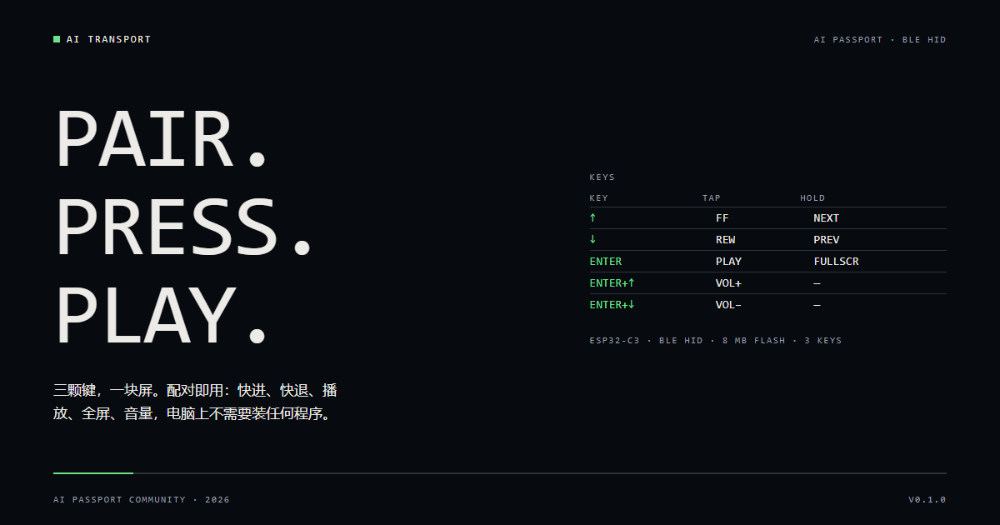

<p align="right">
  <strong>简体中文</strong> · <a href="README.md">English</a>
</p>

# AI Transport — AI Passport 蓝牙播控器

三颗键，一块小屏，电脑上不装任何东西。
用蓝牙 LE HID 配对后，它发送的就是播放器本来就在听的键：快进、播放/暂停、全屏、音量。



## 按键

| 按键 | 短按 | 长按 |
| --- | --- | --- |
| ↑ | 快进（键盘 →） | 下一集 |
| ↓ | 快退（键盘 ←） | 上一集 |
| OK | 播放 / 暂停（Consumer 0xCD） | 全屏（键盘 f） |
| OK + ↑ | 音量加（Consumer 0xE9） | — |
| OK + ↓ | 音量减（Consumer 0xEA） | — |

屏幕只是盲操参考，不是播放器界面：设备名、电量、连接状态、四行按键图例，以及按下后
显示 1.5 秒的动作名。无按键 10 秒后背光全灭，任意按键立即点亮。

没有元数据通道，也没有电脑端程序。全部是标准 BLE HID（一个键盘集合 + 一个消费类集合），
任何接受蓝牙键盘的主机都能用。

## 烧录

1. 打开 AI Passport 网页烧录器：
   <https://ai-passport.folotoy.cn/tools/web-flasher/>（Chrome / Edge）。
2. 选择 `build/FoloToy-AI-Passport-full.bin`（或 Release 里的同名文件），
   波特率 460800，从 `0x0` 开始写入。
3. 在电脑的蓝牙设置里添加设备，选择 **AI Transport**。不需要 PIN（Just Works 配对）。
4. 如果这台主机以前配过别的版本，先在蓝牙列表里移除设备，再重新配对。

## 构建

需要 ESP-IDF 5.5.3（ESP32-C3）。

```bash
./tools/validate.sh --firmware   # 构建 + 合并 + 校验整片镜像
```

对外发布的产物是合并镜像 `build/FoloToy-AI-Passport-full.bin`；
单独的应用镜像 `build/FoloToy-AI-Passport.bin` 不能直接这样烧。

## 已知限制

- 直播没有时间轴。↑/↓ 在直播页仍然发送快进/快退键，但不会刷新页面——设备不知道电脑
  在播什么，也不依赖任何电脑端助手。
- 全屏用的是播放器自己的快捷键（`f`，已在 B 站与 YouTube 网页播放器实测）；没有该
  快捷键的播放器不会响应。
- 音量键是系统消费类按键；设备读不到、也不显示电脑当前音量。
- 从 `0x0` 重刷合并镜像会覆盖整个镜像区域，原有的蓝牙配对可能被清除，需要重新配对。
- 电量百分比取决于实际电芯与电池 profile。

## 目录

- `main/` —— 应用入口、按键映射、HID 报告、LVGL 屏幕。
- `components/bsp/` —— 板级支持：显示、按键（ADC）、电池、I2C。
- `docs/assets/` —— 封面素材与源文件（`cover/cover.html`）。
- `docs/` —— 上游 AI Passport 文档集（硬件指南、开发指南、社区文档）。
  硬件事实以 `components/bsp/include/bsp_pins.h` 为准。

## 许可

MIT，继承自上游 FoloToy AI Passport 项目。见 [LICENSE](LICENSE)。
